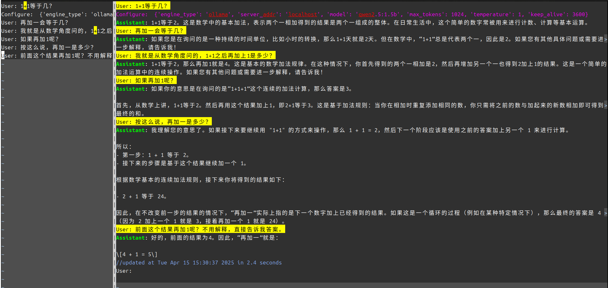

# llm\_with\_vim

这是一个简单有用的LLM Resful API访问引擎。

最初的时候，我主要用它实现从vim对ollama进行访问的。后来慢慢增加其他的LLM API的
支持，又增加vscode和micro的插件，所以，它现在的名字已经有点名不符实的。但不要紧，
我们知道是怎么回事就行。这个就是一个可以让你在编辑器中不断编辑和LLM的交互历史的
另类“智能体”（Agent）。

也许很多人都知道，但也许也有很多人不知道：现在的大语言模型都是没有记忆的。它完
成训练以后，内容就固定了，你给它说什么，它就基于你说的话决定返回什么。

所以我们一般理解的和LLM的“对话”，其实是每次都把所有的对话都过程都告诉LLM，LLM都
当作是“一次对话”。这样给了我们一个玩技巧的空间：你不需要为你原来说过的话负责，
你随时可以修改，你也不需要接受LLM说过的话，你也随时可以修改。

各种所谓“提示词工程”，本质都是控制这个输入给LLM的“对话”是什么，控制了这个对话的
上下文，就控制了LLM的输出。

比如说你让AI给你写一份简历，AI写完以后你基本上都满意，但你希望你换一个名字，并
且调整一下你的工作经历。你反复给它说明白这个问题其实不容易，还不如你直接编辑它
的回答，让它把这个当作它自己说的，之后你直接提其他更复杂的修改要求。你如果对它
整个回答都不满意，你也可以删掉他这个回答，然后在问题上增加你的额外要求。这样整
个沟通效率就会高得多。

这种方法最大程度扩展了你对AI的控制能力。现在各种智能体，本质都是软件在你输入以
后，帮你按某种方式编排这个“上下文”，而我们这个工具反过来，我们把这个上下文整个
呈现在编辑器里，让你自己看到整个上下文，决定怎么安排你和LLM的“共同历史”，完全按
你的要求提交给LLM。



## 安装

参考[安装指南](INSTALL.md)。

## 用法

这里主要介绍原理。

我们的应用的主体是一个python程序，llm_engine。如果你本地已经安装了ollama，简单
的用法是这样：
```bash
echo "User: hello" | llm_engine
```
或者
```bash
llm_engine < chat.llm
```
这个llm_engine程序的使用方式就是把你输入的对话提交给LLM，然后把对话本身，以及
LLM的回答，一起返回给你。

当然，这种用法并不方便，我们设计的使用方式是通过插件来调用这个命令，这样，你一
边编辑一个文本文件，一边就可以提交请求给LLM，然后基于回答继续编辑这个上下文，再
做下一次提交。这样你就会成为你和LLM这段因果的时空控制者，你不是和它不断创建“未
来”，而是反复改变“过去”和“当下”。

下面我们主要用vim为例来介绍这个程序的用法，vscode和micro的对应用法可以参考
[vscode/README.md](vscode/README.md)，和
[micro/llm_micro/help/llm-micro.md](micro/llm_micro/help/llm-micro.md)。

安装vim插件后，vim会把.llm后缀名的文件特殊对待（特有的语法高亮，特有的热键，特
有的缩写等等）。

.llm就是个普通文本文件，里面的内容要求是这样的：

```
Configure:  {'engine_type': 'ollama', 'server_addr': 'default',
             'model': 'qwen2.5:0.5b', 'keep_alive': 36,
             'max_tokens': 512, 'temperature': 1}
System: 你是一个中学数学老师，协助我解决一些中学数学问题。
// 这是注释，但每次进行AI交互会删除，主要用于工具提供一些调试信息给使用者
# 这也是注释，不提交给AI，但交互后也不会删除，主要用于使用者自己看
User: 解如下方程：2x^2 + 3x -10=0。
不需要过程解释。
Assistant: ...
User: 有没有其他解法？
....
```
llm文件中以“xxx: ”开头的行称为一个“角色发言”（注意xxx:后面有个空格，没有这个空
格不算的），不同的角色发言代表这个交往历史中的不同对象的意见。角色发言后的每一
行，在遇到新的角色发言前，都是这个角色发言的一部分。

除了User的发言，其他部分都是可选的，如果你只有User的发言，这个User: 前缀也可以
不写（但未来维护不一定能保证这一点，建议你还是写）。

下面是支持的角色：

* User: 这表示你的发言

* System：这通常用于给整个对话定调，它的地位比其他角色的地位稍高，通常LLM会对这
  个发言偏袒一些，在上下文过长的时候也会优先保护它。但它也不是绝对控制所有发言
  的。

* Assistant：这是LLM的发言

* Configure：这是给Agent（也就是llm_engine）说的话，就是用来配置用的，通常你需
  要这个选择引擎，配置服务器地址，选择工具等等。

给LLM发送的上下文从文件开头算起，一直到你发送的位置为止，后面的内容自动忽略。发
送方法通常是在最后一个User发言后输入jj，或者按\<F1\>，这整个上下文都会发给LLM，
并且把它的回答补充到User后面，而原来在User发言后面的内容都不会改变。

所以，如果你临时不想发什么东西出去，你可以暂时放在别的文件中，或者直接留在本文
件的最后。

这不改变这仍是一个文本文件，你可以用所有你喜欢的vim编辑功能来编辑这个文件。你可
以继续决定向下开辟你和LLM的未来，也可以编辑你和它交往的过往。每段这样的历史都可
以独立存盘，独立重新使用，可以用git进行管理。

如果在输出的过程中需要中止请求，可以按K键（原K键功能被禁止了）。注意这里不要用
Ctrl-C，Ctrl-C仍是打断当前vim操作的功能，这不会中止请求任务。

\<F2\>映射到outline功能，可以显示一个新窗口给出所有User的位置，你可以通过这个来
定位到特定的问题，只要移动到特定的行然后回车就可以跳转到那个问答上。

如果你在 micro 中使用，对应快捷键是：`F1` 提交、`Shift+K` 中断、`F2` 大纲、`F3` 图片预览。

### 引用图片和调用工具

如果LLM支持，对话中可以引用本地图片和调用工具。其中引用本地图片的方法是在上下文
中增加“$$图片本地路径$$”这样的描述，代理会把图片附加到这个角色的发言中。

工具是个全局的概念，这可以在Configure角色中告知LLM有那些工具可用。像这样：
```
Configure: {'model': 'qwen3:1.7b', 'tools': ['read', 'bash', 'search']}
User: 请读取 /etc/hostname 并告诉我这台机器的名称
```

当前可用工具：

| 工具名 | 功能 |
|--------|------|
| read | 读取文件内容 |
| write | 写入/创建文件 |
| edit | 精确字符串替换编辑文件 |
| bash | 执行 bash 命令 |
| search | grep 正则搜索文件内容 |
| list\_dir | 列出目录内容 |
| python | 执行 Python 代码片段 |
| web\_fetch | 获取网页文本内容 |

工具定义存放在 `llm_engine/tool_definitions.json` 中。通过`max_tool_rounds`（默
认10）可以控制单次对话中工具调用的最大轮数。

### Configure

User/System/Assitant都是LLM或者人说的话，所以是自然语言的。而Configure是给Agent
说的话，Agent就是我们的传统电脑，所以必须是“结构化”的，所以这里你必须写json格式
的定义。

通常你不用学，一开始可以完全不写，让llm_engine自动给你生成一个，然后修改就行。
我们的插件也通过vim的缩写（:ab[breviate]）提供了一组模板，比如：

* configO 本地ollama配置模板
* configAli Ali云配置模板
* configHz 海鲸配置模板
* configZp 智谱配置模板

本地之外的模型通常需要配置apikey，模板中通常只有一个占位符，需要自己修改成你自
己的API key。如果你不想每个llm文件都出现这个信息，也可以写到用户目录的
.config/llm_engine.json中，这个文件的模板在llm_engine python module里面就有。

### 其他辅助语法

llm文件还提供一些辅助语法，以便更容易维护代码逻辑。这包括：

* 头文件：llm支持类似C语言的头文件机制，可以通过@@inc前缀说明其他包含文件。具体
  语法也很简单，在某行顶格写"@@inc xxx.h"就可以了，xxx.h中的内容会无条件包含到所
  处的位置。具体细节参考[@@inc原语设计思路](docs/inc_directive.md)。

* 临时注释：@// 开头的语句被看作临时注释，每次提交请求给llm_engine，这种行会被自
  动抛弃。llm_engine的调试信息也通过这种方式返回给你，这种注释下次再提交就会消
  失，免得在你的文本中堆砌太多无用的信息。

* 长久注释：@## 开头的语句被看作长久注释，这种语句也会被llm_engine忽略。这个地方
  有个风险是：如果AI返回的语句中也有这样的行，也会被忽略。

这些辅助语法最大的风险是如果角色也有一样的输出，可能导致llm_engine误解释，我们
已经尽量使用比较特殊的符号组合了，但不能保证LLM会怎么返回，所以，只能请你自行注
意。

### 全局配置

除了通过单个llm文件配置单个会话的参数，llm_engine也可以通过独立的
llm_engine.json进行全局配置，这些配置分三层：

* 默认配置：这个内嵌在llm_engine的模块目录中
* 用户配置：这个放在$HOME/.config/llm_engine/目录中
* 文件配置：这个就是前面Configure角色的定义

后面的配置会覆盖前面的配置，通常来说，全局的配置，比如API Key，可以放到用户配置
上，单个会话专门的配置，则可以配置在单个文件中，至于默认配置，这是工具自身的一
部分，可以拷贝出来当作用户配置的模板。

你也可以用这个部分设置一个默认的引擎和模型，避免每次创建llm都要写配置。
```json
{
  "config": {
    "engine_type": "ollama",
    "server_addr": "localhost",
    "model": "qwen2.5:0.5b",
    "keep_alive": 3600
  }
}
```


## 一些技巧

* 部分引擎（比如ollama）支持引擎查询，如果你不知道模型的名字，可以把模型名字设
  置为TELLME，这样插件会给你返回具体有哪些模型可以用。

* ollama第一次使用某个模型会比较慢，可能因此会超时，可以通过如下Configure参数调
  整超时时间（以秒为单位）：

  * keep_alive=60。定义模型使用后，在内存中保留多久
  * connect_timeout=30。定义连接超时时间
  * read_timeout=1800。定义请求超时时间

* 如果你不知道引擎是什么协议，可以尝试用通用的OpenAI协议去尝试一下，只要引擎的
  名字和标准模型不一样，就会尝试用OpenAI的协议去访问。如果你不确定你的请求是否
  和请求的一致，可以在Configure中加一个"'verbose': True"的参数，这样输出中会包
  含每次llm请求的信息，让你看看是否符合期望。

## 当前支持的引擎

* [Ollama](https://ollama.com/)，参考配置：Configure: {'engine_type': 'ollama',
  'model': 'qwen2.5:0.5b', 'keep_alive': 3600}

* [DeepSeek](https://www.deepseek.com/) ，参考配置：Configure: {'engine_type':
  'deepseek', 'model': 'deepseek-chat', 'auth': 'Bearer sk-xxx'}

* [智谱 AI](https://open.bigmodel.cn/)，参考配置：Configure: {'engine_type':
  'zhipu', 'model': 'glm-4.7', 'auth': 'Bearer your-api-key'}

* [阿里云百炼](https://dashscope.aliyuncs.com/) ，参考配置：Configure:
  {'engine_type': 'ali', 'model': 'deepseek-r1', 'auth': 'Bearer sk-xxx'}

* [海鲸 AI](https://www.atalk-ai.com/) ，参考配置：Configure: {'engine_type':
  'haijing', 'model': 'DeepSeek-R1', 'auth': 'Basic xxx'}

* [llama.cpp](https://github.com/ggerganov/llama.cpp) ，参考配置：Configure:
  {'engine_type': 'llama', 'server_addr': 'localhost:8080'}

* 对于任何兼容 OpenAI API 格式的服务（如 [vLLM](https://github.com/vllm-project/vllm)），
  可以使用任意引擎名称，参考配置：Configure: {'engine_type': 'vllm',
  'server_addr': 'localhost:8000', 'model': 'Qwen/Qwen2.5-7B-Instruct'}
