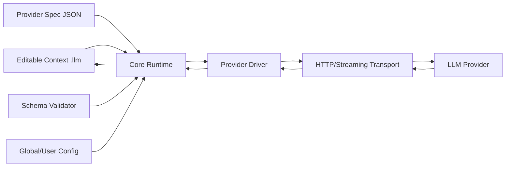

# ContextForge 架构重构设计文档

## 1. 设计目的

- 项目新名称：`contextforge`
- 重构类型：在现有 `llm_with_vim` 能力基础上进行架构抽象与工程化升级（非一次性重写）。
- 核心目标：
  - 消除主流程中大量 `if engine_type == ...` 的分支耦合。
  - 将不同 LLM 平台差异抽象为数据定义（JSON），由 Schema 约束。
  - 将默认行为（如默认模型、默认 server、认证格式、超时策略）收敛到 Provider 配置中。
  - 统一用户级配置目录，采用类似主流 Agent 工具的配置方式。
  - 保留并强化“可编辑上下文即记忆”的产品哲学。

### 1.1 现状问题

当前实现在功能上可用，但存在以下系统性问题：

1. Provider 逻辑与请求主流程耦合
- endpoint、认证、模型默认值、流式解析等散落在核心流程中。
- 新增一个平台通常要修改多个分支，回归风险高。

2. 默认推断策略分散
- “没配 server 则 localhost”“模型别名推断”等规则分散在代码。
- 行为可预测性下降，维护者不易定位最终配置来源。

3. 配置位置与命名历史包袱
- 配置文件位置和命名围绕早期 Vim 插件场景。
- 不利于扩展到更通用的编辑器/Agent 场景。

4. 协议差异扩散
- 各平台对 stream/tool/reasoning/多模态格式差异较大。
- 缺少统一的 provider 抽象边界。

## 2. 设计逻辑

### 2.1 设计原则

1. 核心流程稳定，Provider 差异数据化
- Core Runtime 不直接关心“某平台叫啥”，只消费 Provider Spec。

2. 声明式优先，脚本化兜底
- 绝大部分差异通过 JSON 声明描述。
- 仅当协议差异无法声明式表达时，允许受控内置 hook（函数名白名单）。

3. 兼容优先、渐进迁移
- 通过“兼容层 + 迁移器”逐步替换旧分支，避免 Big Bang。

4. 可观测与可诊断
- 配置合并、schema 校验、请求构造、响应解析都要可追踪。

5. 上下文可编辑哲学不变
- 用户编辑文件是第一交互入口。
- Provider 抽象不改变“记忆可编辑”这一核心体验。

### 2.2 总体架构



分层职责：

1. Core Runtime
- 输入解析（角色、include、工具、图片等）
- 配置合并（全局/Provider/会话）
- 工具调用循环与上下文写回
- 错误输出与退出码规范

2. Provider Spec（JSON）
- 声明 provider 的能力、默认值、请求/响应映射、认证策略

3. Provider Driver
- 按 spec 构建请求
- 按 spec 解析响应流（必要时调用受控 hook）

4. Schema Validator
- 在加载配置时做严格校验，尽早失败

## 3. 核心概念与数据结构

### 3.1 Provider Spec（核心）

每个 provider 对应一个 JSON 文件（例如 `providers/ollama.json`）。

建议核心字段：

- `id`: provider 唯一标识，如 `ollama`
- `display_name`: 展示名
- `protocol`: `openai_compat | ollama_native | custom`
- `defaults`: 默认参数集合（模型、超时、温度、stream 等）
- `endpoint`: URL 模板与默认 host/port/path
- `auth`: 认证策略声明（header/query/none）
- `request_mapping`: 统一内部请求字段到 provider 请求字段映射
- `response_mapping`: 响应解析模式声明
- `features`: 能力开关（tools、reasoning、vision、json_mode 等）
- `aliases`: model/server 别名映射
- `fallbacks`: 默认推断规则（比如 host 缺失时使用 localhost）
- `hooks`（可选）: 内置 hook 名（白名单）

### 3.2 统一内部请求模型（IR）

Runtime 构造统一 IR，Provider Driver 仅做 IR -> Provider Payload 映射。

```json
{
  "messages": [...],
  "model": "...",
  "temperature": 1.0,
  "max_tokens": 1024,
  "stream": true,
  "tools": [...],
  "thinking": false
}
```

### 3.3 Provider Schema 元信息

Schema 文件需包含版本字段：

- `schema_version`: `1`
- `spec_version`: 由每个 provider 文件维护

用于后续升级兼容与自动迁移。

## 4. 接口定义

### 4.1 Runtime 对 Provider Driver 接口

- `load_provider_spec(provider_id) -> spec`
- `validate_provider_spec(spec) -> ok/error`
- `build_provider_request(ir, spec, resolved_config) -> payload`
- `send_request(payload, spec, auth_ctx) -> response_stream`
- `parse_stream_chunk(chunk, spec) -> events`

### 4.2 配置解析接口

- `load_global_config()`
- `load_provider_overrides(provider_id)`
- `load_session_config_from_context()`
- `merge_config(base, provider_defaults, session_overrides)`

### 4.3 兼容接口

- `legacy_config_migrate(old_config) -> new_layout`
- `legacy_engine_type_resolve(name) -> provider_id`

## 5. 配置目录规范

采用用户级配置目录：

- Linux/macOS: `~/.config/contextforge/`
- Windows: `%APPDATA%/contextforge/`

推荐目录结构：

```text
contextforge/
  config.json
  providers/
    ollama.json
    openai_compat.json
    zhipu.json
    ali.json
    deepseek.json
  schemas/
    provider.schema.json
  secrets/
    (可选，或改用系统 keyring)
  migrations/
    (迁移状态记录)
```

## 5.1 配置归属与覆盖关系（关键设计视图）

本节定义 ContextForge 的配置契约：

1. 哪些配置属于应用（App-owned）
2. 哪些配置属于用户（User-owned）
3. 哪些配置属于会话/上下文（Session-owned）
4. 它们如何覆盖，哪些字段允许覆盖

这是 Provider 抽象能否长期稳定的核心前提。

### 5.1.1 配置层级模型

从低到高分为 6 层：

1. Layer 0: 应用内置默认（只读）
- 来源：包内默认配置与内置 provider spec。
- 目标：保证零配置可运行。

2. Layer 1: 应用安装级扩展（可选）
- 来源：系统级目录（如 `/etc/contextforge/`）。
- 目标：组织级统一基线（企业内网、统一代理、合规策略）。

3. Layer 2: 用户全局配置
- 来源：`~/.config/contextforge/config.json`。
- 目标：用户长期偏好（默认 provider、默认模型、超时、输出风格）。

4. Layer 3: 用户 provider 覆盖
- 来源：`~/.config/contextforge/providers/*.json`。
- 目标：用户对某 provider 的本地定制（server alias、model alias、默认参数）。

5. Layer 4: 工作区配置（可选）
- 来源：工作区内配置文件（后续可支持）。
- 目标：团队项目共享非敏感默认值。

6. Layer 5: 会话配置（上下文中的 `Configure:`）
- 来源：当前 `.llm` 文件。
- 目标：当前会话临时覆盖，优先级最高。

覆盖规则：高层覆盖低层，仅对“允许覆盖”的字段生效。

### 5.1.2 字段归属分类

将配置字段分三类：

1. App-owned（应用控制，不允许会话覆盖）
- 例：安全开关、危险工具禁用列表、最大请求体限制、实验特性总开关。
- 原则：保证运行安全和可维护性。

2. User-owned（用户偏好，允许会话局部覆盖）
- 例：默认 provider、默认模型、温度、max_tokens、timeout、thinking。
- 原则：用户可长期设定，单次会话可临时调整。

3. Session-owned（会话强相关，默认允许覆盖）
- 例：当前请求工具列表、当前会话模型切换、临时 server 地址。
- 原则：以当前编辑上下文意图为准。

### 5.1.3 覆盖白名单机制

为避免“会话可改一切”，每个 Provider Spec 必须声明可覆盖白名单：

- `overrides.allowed_in_session`: 会话可覆盖字段列表
- `overrides.allowed_in_workspace`: 工作区可覆盖字段列表（可选）
- `overrides.readonly`: 只读字段列表

示例：

```json
{
  "overrides": {
    "allowed_in_session": [
      "model",
      "temperature",
      "max_tokens",
      "tools",
      "thinking",
      "server_addr"
    ],
    "readonly": [
      "protocol",
      "response_mapping.mode"
    ]
  }
}
```

当会话层尝试覆盖只读字段时：

- 默认行为：拒绝覆盖并输出可见警告
- 严格模式：直接失败退出（用于 CI/团队规范场景）

### 5.1.4 合并算法承诺

必须明确并固定以下行为：

1. 合并顺序
- Layer 0 -> 1 -> 2 -> 3 -> 4 -> 5

2. 合并策略
- 标量：后者覆盖前者
- 对象：深度合并
- 数组：默认替换（不做隐式拼接）

3. 空值语义
- `null` 表示显式清空（仅对白名单字段生效）
- 未出现字段表示“不修改”

4. 别名解析时机
- 先合并，再做 alias 解析与规范化
- 规范化后再做最终请求映射

5. 校验时机
- 每层加载先做 schema 校验
- 合并后做一次最终校验

### 5.1.5 Provider 定义与用户覆盖的边界

Provider Spec 负责“协议和能力”，用户配置负责“参数和偏好”。

1. Provider Spec（协议契约）
- protocol
- endpoint template
- response_mapping mode
- feature capability
- override policy

2. 用户配置（运行值）
- 默认 provider
- 默认模型
- timeout
- 温度和 token 策略
- secrets 引用

不建议用户覆盖协议契约字段（例如把 `response_mapping.mode` 从 `json_line_ollama` 改成 `sse_openai_delta`），这类应通过“新 provider spec”实现，而不是在运行时硬改。

### 5.1.6 冲突与可观测性

每次请求建议生成“配置决议快照”（可选 debug 输出）：

- 字段最终值
- 值来源层级（L0-L5）
- 被拒绝的覆盖项

示例（概念）：

```text
model = deepseek-r1:32b  (source: L5 Configure)
server_addr = localhost  (source: L3 provider override)
response_mapping.mode = json_line_ollama (source: L0 readonly, override denied at L5)
```

这能显著降低“为什么最终发的是这个请求”的排障成本。

## 6. Provider Schema v1（第一步设计）

本节是第一步可落地范围，先保证可用，再扩展。

### 6.1 v1 必须支持

1. endpoint 与默认 host/port/path
2. 认证策略：none/header（含 Bearer/Basic 前缀模板）
3. 默认参数：model/temperature/max_tokens/connect_timeout/read_timeout/stream
4. 请求字段映射（含可选字段存在性控制）
5. 响应模式：
- `json_full`
- `sse_openai_delta`
- `json_line_ollama`
6. tools 能力开关与字段映射
7. reasoning/thinking 能力声明（支持/不支持/字段名）
8. model/server alias

### 6.2 v1 有意不做

1. 任意脚本表达式
2. 用户自定义可执行代码
3. 复杂条件路由（多 endpoint 负载均衡）
4. provider 间链路编排

### 6.3 Provider Spec v1 示例（草案）

```json
{
  "schema_version": 1,
  "spec_version": 1,
  "id": "ollama",
  "display_name": "Ollama",
  "protocol": "ollama_native",
  "defaults": {
    "model": "qwen2.5:0.5b",
    "connect_timeout": 30,
    "read_timeout": 1800,
    "stream": true,
    "thinking": false,
    "keep_alive": 3600
  },
  "endpoint": {
    "template": "http://{host}:{port}/api/chat",
    "default_host": "localhost",
    "default_port": 11434
  },
  "auth": {
    "type": "none"
  },
  "aliases": {
    "server": {
      "default": "localhost"
    },
    "model": {
      "qwen": "qwen2.5:0.5b"
    }
  },
  "features": {
    "tools": true,
    "vision": true,
    "reasoning": true
  },
  "request_mapping": {
    "messages": "messages",
    "model": "model",
    "temperature": "temperature",
    "max_tokens": "max_tokens",
    "stream": "stream",
    "tools": "tools",
    "keep_alive": "keep_alive",
    "thinking_false_field": {
      "field": "think",
      "value": false
    }
  },
  "response_mapping": {
    "mode": "json_line_ollama",
    "content_path": "message.content",
    "tool_calls_path": "message.tool_calls"
  }
}
```

## 7. 迁移方案

### 7.1 阶段化迁移

1. Phase A: 架构脚手架
- 引入 Provider Spec 加载与 Schema 校验，不改现网行为。

2. Phase B: 并行运行
- 先迁移一个 provider（建议 ollama）到新路径。
- 保留旧 if 分支作为 fallback。

3. Phase C: 扩展 provider
- 逐个迁移 deepseek/zhipu/ali/llama/openai_compat。

4. Phase D: 收口
- 删除旧分支、保留兼容解析与迁移器。

### 7.2 配置迁移

- 启动时检查旧配置文件。
- 自动迁移至 `~/.config/contextforge/`。
- 迁移失败不覆盖，输出可恢复提示。

### 7.3 CLI 与命名迁移

建议保留过渡期别名：

- 新命令：`contextforge`
- 过渡别名：`llm_engine`（打印 deprecation 提示）

## 8. 一致性与缓存命中策略

与前述上下文一致性设计保持一致：

1. 请求体稳定序列化（固定 key 顺序与 separators）
2. Tool 角色标准编码（可编辑且可重放）
3. 编辑点之前稳定前缀不变
4. provider 映射层避免“未编辑情况下重排字段”

## 9. 风险与对策

1. 风险：JSON 配置表达能力不足
- 对策：先覆盖 80% 场景，剩余通过受控 hook 补齐。

2. 风险：Schema 设计过度复杂
- 对策：v1 保持最小字段集，后续增量版本化。

3. 风险：迁移期双路径行为不一致
- 对策：增加 golden case 回放测试，对比新旧输出。

4. 风险：用户密钥存储安全
- 对策：优先支持系统 keyring，文件存储仅作兼容选项。

## 10. 验收标准

1. 主流程不再出现 provider 大量分支判断。
2. 新增 provider 可通过“新增 spec + 少量测试”完成。
3. 默认值与推断规则可从 spec 一眼看全。
4. 老用户配置可自动迁移并可回滚。
5. 关键回归测试通过：
- 请求成功与失败路径
- stream 解析
- tools 循环
- 可编辑上下文重放

## 11. 下一步（讨论输入）

建议在进入编码前，先确认以下决策：

1. Provider Schema v1 字段是否冻结（特别是 `request_mapping`/`response_mapping`）
2. `hooks` 是否在 v1 开放，还是先完全禁用
3. secrets 默认策略：文件还是 keyring 优先
4. 迁移期命令别名保留多久
5. 文档和仓库重命名节奏（先内部模块名还是先外部命令名）

## 12. 变更历史

| 日期 | 变更内容 | 原因 |
|---|---|---|
| 2026-07-28 | 创建 ContextForge 总体架构设计与 Schema v1 草案 | 支撑 Provider 抽象重构讨论 |
